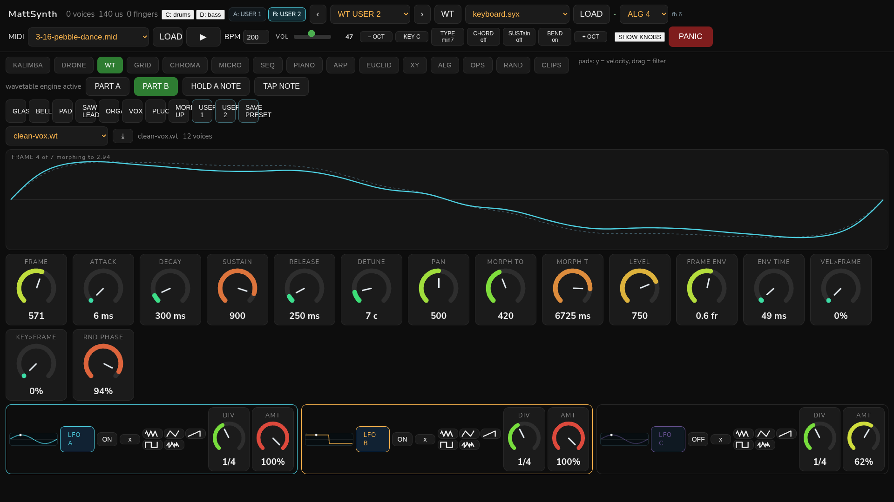
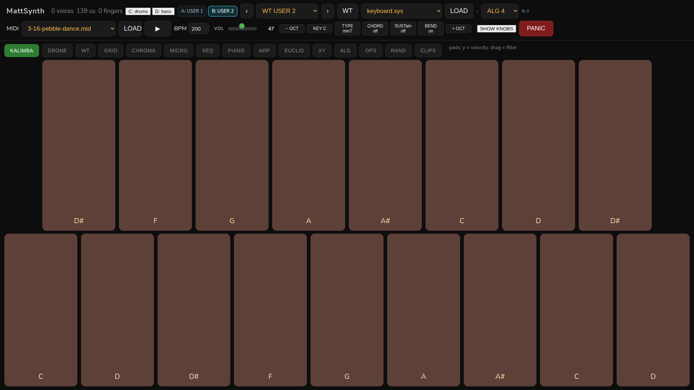
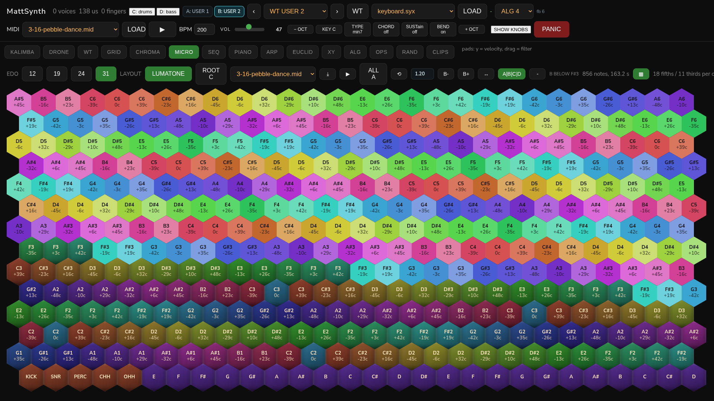
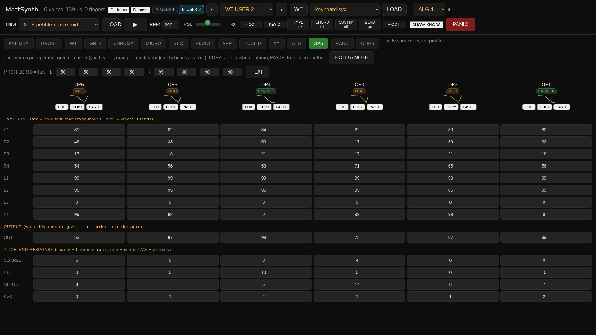
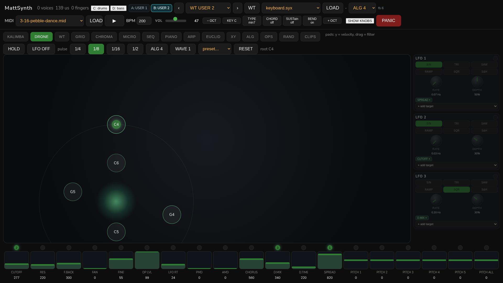

# MattSynth

A two-part FM and wavetable synthesiser with a 14 inch touch panel, an analogue drum
machine on the same musical clock, and a microtonal keyboard you can split across four
instruments.

The Daisy Pod does the audio, a Raspberry Pi serves the interface to a kiosk Chromium, and
an Akai Rhythm Wolf adds analogue drums and bass over USB MIDI.



## What is in the box

    Daisy Pod            6 operator FM, 8 frame wavetable engine, 12 voices, two parts
    Raspberry Pi 400     runs the panel and the USB bridges
    Caperave 15" panel   touch, 1920x1080, driven by kiosk Chromium
    Akai Rhythm Wolf     analogue drums on part C, its bass synth on part D

## Screenshots

| | |
|---|---|
|  **Kalimba** two staggered rows of fat tines, velocity from where the finger lands |  **Microtonal** Lumatone style honeycomb, 12 to 31 EDO, four instrument zones |
|  **Operators** six operators, envelopes, routing, per operator detail with draggable handles |  **Drone** three LFO bay with stones, feedback and per LFO targets |

## Features

**Engines.** A DX7 class six operator FM engine with 32 algorithms and 155 byte packed
voices, and a wavetable engine with eight additive frames, per voice morph, four stage
envelope and detune. `P 28` switches between them at runtime, both share the filter,
chorus, delay, pan and voice pool, so the switch costs nothing.

**Microtonal.** 12, 19, 24 and 31 EDO, a honeycomb keyboard with per key cents, chord
tones lit, press glow, glissando drag mode, and a keyboard split into four zones.

**Modulation.** Three LFOs per part with a 14 destination amount matrix. One LFO can drive
FRAME, MORPH TO and DETUNE at once with separate depths, and every knob draws a band per
source with a live marker riding that band.

**Drums and bass.** The Rhythm Wolf is part C on channel 10 and its bass is part D on
channel 1. MIDI files can drive all four parts: channel 0 rhythm, 1 lead, 9 drums,
2 bass.

**Files.** A built in MIDI player with two part routing, loop, microtonal cents per note
and the whole arrangement clocked from the panel transport.

## How it fits together

```
   touch panel (1920x1080)          Raspberry Pi                    instruments
  +----------------------+      +------------------+          +--------------------+
  |  kiosk Chromium      | <--> |  panel_ui.py     |  USB CDC |  Daisy Pod          |
  |  HTML, canvas, JS    |  ws  |  HTTP + WS + SSE | -------> |  FM and wavetable   |
  +----------------------+      |                  |          +--------------------+
                                |  podbridge       |          +--------------------+
                                |  rawmidi         |  USB MIDI|  Rhythm Wolf        |
                                +------------------+ -------> |  drums and bass     |
                                                              +--------------------+
```

Notes are integers over a framed link, `@body*checksum`, so nothing floats on the wire.
State lives in `panel_state.json` on the Pi and is restored on boot, including the bank,
the wave set and the file you had loaded.

## Getting started

Firmware:

    cd firmware/daisy-pod
    make
    dfu-util -d 0483:df11 -a 0 -s 0x08000000:leave -D build/PanelLink.bin

The app can reboot itself into the bootloader with the `Z` verb, so no BOOT press is
needed after the first flash.

Panel:

    python3 panel/panel_ui.py          # serves http://<pi>:8080
    kiosk                              # Chromium on the panel, see panel/systemd

Both run as systemd units, see `panel/systemd`.

## Repository layout

    firmware/daisy-pod   PanelLink.cpp, FmEngine.h, WtEngine.h, Makefile
    panel/panel_ui.py    the entire UI and both bridges
    panel/systemd        panel-ui, kiosk, podbridge
    tools/               composition scripts, wave set generator, flash helpers
    docs/PROTOCOL.md     the wire protocol and the modulation matrix
    docs/images          screenshots

## Status

Working: FM and wavetable engines, two part multitimbral, three LFOs with a modulation
matrix, microtonal honeycomb with four zones, MIDI player, Rhythm Wolf integration, MIDI
over a websocket transport, banks and wavetable sets.

Next: operator level scaling curves, a real FFT band limit for loaded wave sets, and an
arrangement view for the sequencer.

## Licence

MIT, see LICENSE.
